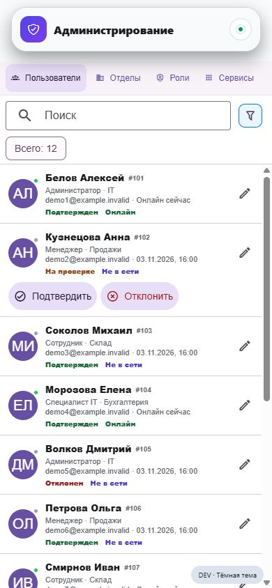
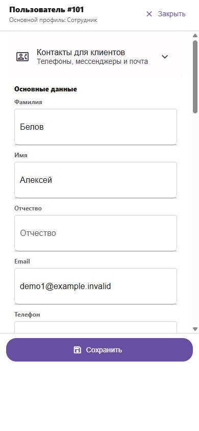
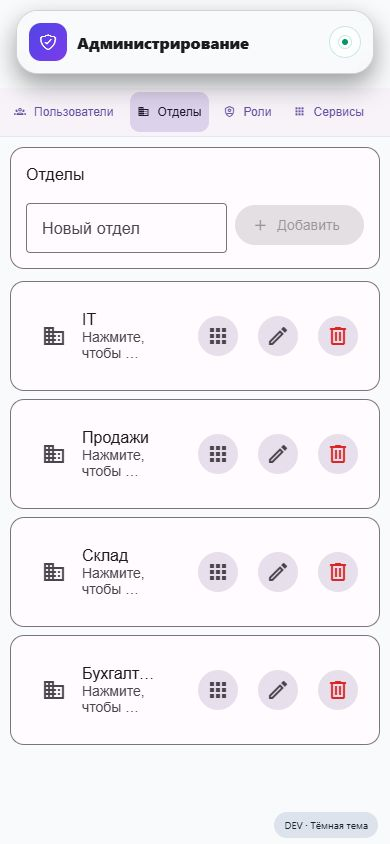
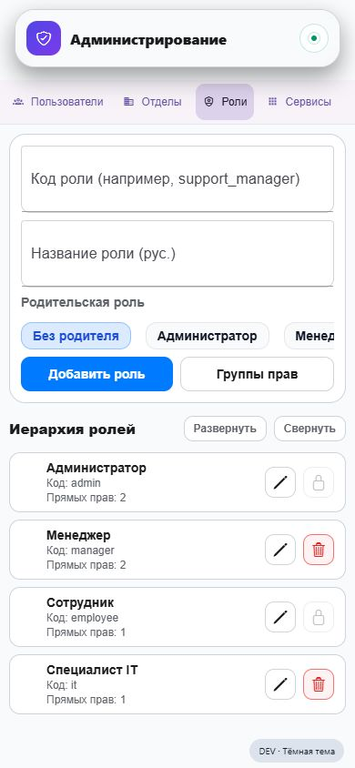
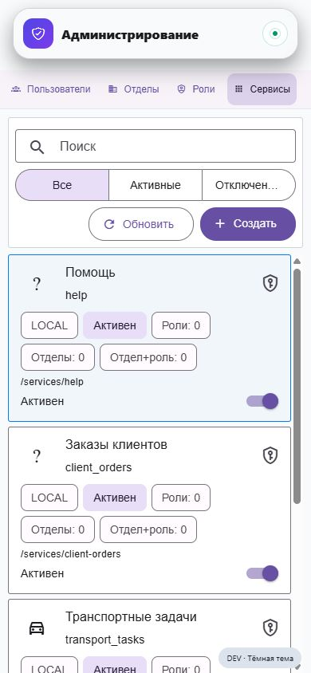
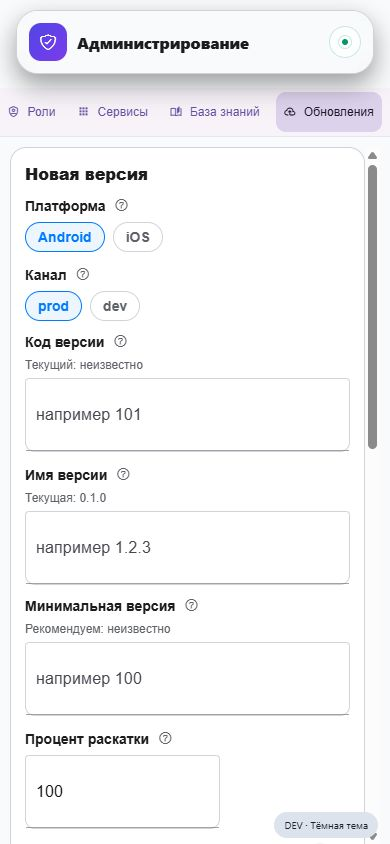

# Редизайн «Администрирования» в стиле «Помощи»

Дата: 3 ноября 2026. База APP: `dev`, `a051bcf`. Проверены реальные React Native-компоненты в отдельном стенде с синтетическими данными. Изменений учётных записей, прав или данных dev/prod нет.

## Что должно получиться

Администратор быстро находит человека, проверяет заявку, меняет доступ и понимает последствия действия. Мобильная версия использует те же шапки, блюр, сетку, цвета и анимации, что «Помощь». Десктоп сохраняет эффективность двух колонок. Шесть существующих разделов остаются доступными: пользователи, отделы, роли, сервисы, база знаний, обновления. Новые административные полномочия не вводятся.

## Аудит — экраны сняты в этом запуске

| Шаг | Экран и состояние | Наблюдение и исправление |
|---|---|---|
| 1 | [Пользователи](screenshots/01-users-current.png) — список работает, иерархия слабая | Шапка, полоса разделов и поиск занимают около 235 из 844 px. Много мелких вторичных строк. Убрать отдельную тяжёлую капсулу; поиск встроить в компактную общую шапку. Имя 16 px, роль/отдел 13–14 px, вторичные данные только по необходимости. Онлайн обозначать точкой и подписью в профиле. Статус проверки не смешивать со статусом активности. |
| 2 | [Пользователь](screenshots/02-user-editor-current.png) — форма открывается, перегружена | Длинная форма смешивает имя, пароль, статусы, оргструктуру, 1С и контакты для клиентов. Открывать профиль отдельным экраном; основные сведения наверху, разделы «Доступ», «1С», «Контакты» ниже. Настройки безопасности и статусов — отдельные подтверждаемые действия. Сохранение фиксировано над клавиатурой; при уходе с изменениями — предупреждение. |
| 3 | [Отделы](screenshots/03-departments-current.png) — действия есть, названия обрезаются | Карточки с тремя постоянно видимыми кнопками сжимают названия и описание. Плоские строки: иконка/название/число сотрудников/переход. Редактирование и удаление — меню строки. Добавление отдела — отдельная форма вместо постоянного блока. |
| 4 | [Роли](screenshots/04-roles-current.png) — иерархия есть, первое действие заслоняет список | Форма создания занимает почти половину экрана. Код роли — вторичный технический реквизит. Сначала дерево/список ролей, затем явное добавление. В редакторе различать унаследованные права и собственные переопределения; показывать результат доступа до сохранения. |
| 5 | [Сервисы](screenshots/05-services-current.png) — управление доступно, слишком много реквизитов | LOCAL, внутренний маршрут и несколько счётчиков занимают основное место. В списке оставить название, состояние и краткий итог доступа; детали открыть отдельно. У опасного отключения показывать затронутые группы и подтверждение. Значки на старом снимке частично не соответствуют семейству из-за первоначального fixture; это исправлено в тестовых данных и не считается доказанным дефектом production. |
| 6 | [Обновления](screenshots/06-updates-current.png) — форма есть, выпуск требует больше контекста | История релизов находится после большой формы, рядом есть очистка. Сначала список выпусков с каналом/dev–prod, версией и состоянием. Создание и очистка — отдельные действия. Перед публикацией показывать сводку канала, обязательности, раскатки, файла и подписи; сохранить серверные проверки. |

Референс: [реальный список «Помощи»](screenshots/07-help-style-reference.png). Панель QA над ним не относится к дизайну приложения. Дополнительно проверен [нативный APK](screenshots/08-admin-native.png) и [переход в отделы](screenshots/09-departments-native.png). База знаний в fixture выключена: публикация/редактирование документов здесь не оценивались, развитие этого раздела ранее отложено пользователем.

## Единая система оформления

- Переиспользовать `APP_TOOLBAR_LAYOUT`: поля 16 px, круглые действия 48 px, промежуток 8 px. Текст и аватары разных списков стоят на общих вертикалях.
- `AppScreenBlur`, `AppEdgeBlur` и `APP_EDGE_BLUR` — одна реализация верхнего/нижнего блюра. Контент идёт под шапкой; никаких самостоятельных белых/чёрных подложек.
- Палитру брать из `helpThemeTokens`: light `#F7F9FC` / `#18212D`, dark `#151B22` / `#F2F4F7`, акцент `#3289FF` / `#398DFF`. Вынести общую поверхность/типографику из feature Help в shared UI, сохранив совместимый экспорт.
- Общие компоненты: шапка, строка пользователя, строка сущности, выбор раздела, фильтры, редактор, меню действий, подтверждение. Обходить API/проверки прав ради дизайна нельзя.
- Обычные списки — без отдельных обведённых карточек и тяжёлых теней; выделение всей строки. Минимальная зона нажатия 48 px, иконки с доступными подписями, статус не передаётся только цветом.

## Логика и плавность

По исходникам `useUsersData` отправляет запрос при каждом изменении поиска и включает общий loading. Нужны задержка поиска 250–300 ms, отмена устаревших запросов/защита от запоздавшего ответа и сохранение предыдущего списка во время обновления. Кешировать состояние раздела, фильтры и положение списка. После изменения пользователя обновлять его строку; повторно получать весь список только когда изменились состав/сортировка или нужен явный refresh. На первом входе skeleton, на повторном — сохранённый список. Различать пустой список, пустой результат поиска, отсутствие прав и ошибку сети.

Сохранить FlatList/пагинацию пользователей. Не добавлять тяжёлую общую LayoutAnimation ко всем строкам. Переходы экранов и sheet — единая длительность около 180–220 ms с учётом reduced motion; клавиатура двигает форму/кнопку синхронно.

## Порядок реализации после выбора направления

1. Общая шапка, палитра и выбор разделов; карточки/списки пока сохраняют рабочую логику.
2. Пользователи: строки, поиск, фильтры, ожидающие проверки, профиль, модерация.
3. Отделы и роли: общие строки, редакторы, наследование прав и предпросмотр результата.
4. Сервисы: список, экран доступа и понятные состояния наследования.
5. Обновления: история, форма отдельного выпуска, проверка канала и подтверждение публикации.
6. Проверка светлой/тёмной темы, 320/390/430 px, клавиатуры, длинных ФИО, больших списков и Android. Затем перенос выбранного дизайна в основную dev-сборку.

## Отдельный APK для быстрых итераций

`qa/admin-preview` использует настоящие экраны и локальные данные. Package `com.leaderproduct.admin.dev`, порт Metro 8110. Сохранение исходников обновляет APK через Fast Refresh; APK пересобирать нужно только при изменении нативных зависимостей. Основной entry приложения не изменён. [Запуск и сборка](../../../qa/admin-preview/README.md).

## Границы проверки

Это UX-аудит отображения и навигации, не проверка административных полномочий, доставки сообщений, 1С и production-операций. Контраст, размеры текстов/зон и доступность требуют отдельного измерения на выбранном варианте; полное соответствие accessibility не заявляется. На Android проверены запуск, список, переход раздела и Fast Refresh; все CRUD и публикация обновлений на сервере не выполнялись.

## Визуальные варианты

Три самостоятельных изображения созданы встроенным Image Gen на основе снятых экранов и реального Help-референса. Нумерация соответствует порядку отображения в чате: [1](concepts/01.png), [2](concepts/02.png), [3](concepts/03.png). Пользователь выбрал **вариант 2**. В изолированном стенде на порту 8110 обновлены каталог, все шесть разделов и карточки. Статусы и счётчик перенесены в фильтр, ожидающие проверки идут первыми. Пользовательская карточка включает привязку пользователя/физлица 1С с поиском и ФИО, ID Telegram/MAX и отдельную форму сброса пароля. Все нижние панели переиспользуют `HelpSheet` из «Помощи». Главный entry и production не изменены. В коде используются общие Help-токены, реальные компоненты и иконки; растровый макет не используется как интерфейс.

## Снятые исходные экраны

1. Пользователи — список работает, требует более ясной иерархии.

2. Редактор пользователя — открывается, требует разделения длинной формы.

3. Отделы — работают, названия и действия конкурируют за место.

4. Роли — иерархия работает, постоянная форма заслоняет список.

5. Сервисы — доступны, основное содержимое перегружено техническими реквизитами.

6. Обновления — форма доступна, история и подтверждение публикации требуют перестройки.

